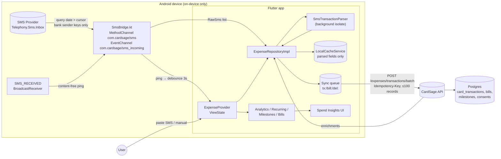

# SMS-Based Credit Card Expense Tracking

> Feature: `lib/features/expenses/` · Status: Flutter client implemented, backend contract specified (no backend lives in this repo) · Last updated: Oct 2026

CardSage reads **bank credit card alert SMS** on Android, works out which card was used, where, how much and the transaction type, filters out everything that is not a transaction, and turns the result into expense analytics: category breakdown, per-card spend, merchants, monthly trend, bills due, recurring charges and card milestones. It works the way CRED and CheQ do, with one difference: **SMS text is parsed on the phone and never uploaded**.

---

## 1. Research summary

### 1.1 How comparable Indian apps ingest transactions

| App | Ingestion method | Notes |
|---|---|---|
| **CRED** | SMS + linked email ("CRED Protect") | Its privacy policy says that, with permission, it collects financial SMS/email data such as bank name, the card's last 4 digits, total/minimum due and due date, and that it can collect other financial/transactional data from email. Consent can be revoked in settings. [CRED privacy policy](https://cred.club/legal/privacy) |
| **CheQ** | SMS + email ("CheQ Safe") + permitted web scraping | Uses card transaction and repayment data extracted from SMS and email for due dates, amounts and "Wisor" insights. It **engages third-party service providers to retrieve details from SMS** and holds CASA certification for email access. [CheQ privacy policy](https://cheq.one/legal/privacy-policy), [CheQ T&C](https://cheq.one/legal/terms-and-conditions) |
| **axio (formerly Walnut)** | SMS, auto-tracked | Markets itself as "SMS-based money management". It claims SMS data stays on the device and that it does not read OTP or personal messages. [Play listing](https://play.google.com/store/apps/details?id=com.daamitt.walnut.app), [axio blog](https://www.axio.co.in/blogs/managing-money-with-axio) |
| **Fold** | RBI **Account Aggregator** (AA) | No SMS parsing; explicit, revocable consent. [App Store](https://apps.apple.com/in/app/fold-money/id1626994334) |
| **Jupiter (Money tab)** | Account Aggregator via licensed AAs (e.g. Finvu) | Consent-controlled access. [jupiter.money/money](https://jupiter.money/money/) |
| Industry commentary | — | Notes that SMS permission is all-or-nothing, so a trustworthy implementation must keep non-financial SMS off its servers. [TechPP CRED vs CheQ](https://techpp.com/2023/02/19/cred-vs-cheq-comparison/), [tnapk.in comparison](https://tnapk.in/best-expense-tracker-apps-for-upi-users-in-india/) |

**Takeaway:** SMS is still the only zero-integration, real-time signal on Android, but the market is moving towards AA for consent-based bank feeds. The best privacy posture is the axio model (on-device parsing) rather than the CheQ model (third-party SMS retrieval).

### 1.2 Android permissions

* `READ_SMS` lets the app query the SMS content provider (`Telephony.Sms.Inbox`), which is needed for the history backfill. `RECEIVE_SMS` lets it receive the `SMS_RECEIVED` broadcast for real-time alerts.
* Both are *dangerous* permissions in the SMS group, so they need a runtime grant. Both also imply the `android.hardware.telephony` feature; we declare that feature `required="false"` so tablets can still install the app.
* We **do not** request `SEND_SMS`, `RECEIVE_MMS`, `RECEIVE_WAP_PUSH` or any phone/call-log permission. Requesting the minimum set reduces Play review risk.

### 1.3 Google Play SMS & Call Log policy

Source: [Use of SMS or Call Log permission groups](https://support.google.com/googleplay/android-developer/answer/10208820).

* By default, only the default SMS, Phone or Assistant handler may use these permissions. Other apps need a **temporary exception** for a listed core use case where no alternative exists.
* The relevant exception categories are:
  * **"SMS-based money management — e.g. apps that track and manage budget"**, which covers `READ_SMS`, `RECEIVE_SMS`, `RECEIVE_MMS` and `RECEIVE_WAP_PUSH`. **This is CardSage's category.**
  * "SMS-based financial transactions (e.g. UPI)", which is not our case.
* Requirements:
  * The use must be the app's **critical core functionality** and be prominently described in the store listing.
  * A **Permissions Declaration Form** must be filed in Play Console. It must be re-submitted whenever usage changes, and undeclared or deceptive use can get the app or developer account suspended.
  * The **Spyware policy** applies: *"personal loans or budgeting apps may not exfiltrate or share non-financial or personal SMS history"*.
  * **User Data policy**: a privacy policy, plus a **prominent in-app disclosure and affirmative consent before the runtime prompt**.
* Invalid uses include research or market research based on SMS, and any transfer that results in a sale of the data.
* Upcoming change (effective 27 Jan 2027): phone-call account verification is no longer a permitted `READ_CALL_LOG` use. This doesn't affect us.

### 1.4 iOS

iOS has **no public API to read the SMS inbox**. `ILMessageFilterExtension` only classifies messages from unknown senders for junk filtering, and its extension cannot persist or export message content to the host app. CRED and CheQ rely on email on iOS.

**Decision (implemented):** On iOS, the Spends tab shows an "SMS reading is Android-only" notice and offers two paths:
1. **Paste a bank SMS.** The user long-presses an alert, copies it and pastes it into the app. It is parsed on-device by the same parser.
2. **Manual entry.**

Two more options are on the roadmap: email statement parsing (the backend reads Gmail/Outlook with restricted OAuth scopes, which requires a CASA security assessment) and Account Aggregator integration (the best long-term option for iOS).

### 1.5 Indian SMS sender IDs (headers)

* Format: `XY-ABCDEF[-S|T|P|G]`.
  * `XY` is a 2-letter operator/circle prefix (e.g. `AD`, `VM`, `JD`, `BP`, `AX`).
  * `ABCDEF` is the DLT-registered header core (e.g. `HDFCBK`, `ICICIT`, `SBICRD`, `AXISBK`, `KOTAKB`, `AMEXIN`).
  * Some handsets drop the prefix entirely.
* **TCCCPR amendment (12 Feb 2025)**: headers must carry a category suffix, `-P` (promotional), `-S` (service), `-T` (transactional) or `-G` (government). Operators append it automatically after DLT template scrubbing. It has been enforced since **6 May 2025** and COAI confirmed that all TSPs have implemented it.
  * Sources: [TRAI regulation PDF](https://www.trai.gov.in/sites/default/files/2025-02/Regulation_12022025.pdf), [Tanla explainer](https://www.tanla.com/blog-posts/trai-mandates-new-message-suffixes-heres-what-you-need-to-know), [Communications Today](https://www.communicationstoday.co.in/suffix-system-on-sms-headers-implemented-threat-from-ott-remains/)
* TRAI publishes the full header list: [TRAI header list](https://www.trai.gov.in/node/7411). Use it to verify and extend the bundled registry.
* How the parser uses this:
  * `-P` is rejected outright.
  * `-T`/`-S` adds a small confidence bonus.
  * Phone-number senders are always rejected, as anti-spoofing.
  * An unknown header is accepted only when it has a `-T`/`-S` suffix **and** the body names a known bank.

### 1.6 Bank SMS formats handled (synthetic samples from the unit tests)

| Issuer | Typical template |
|---|---|
| HDFC Bank | `Spent Rs.1,234.00 On HDFC Bank Card 1234 At AMAZON On 2025-05-01:10:12:13.Not You? … BLOCK CC 1234 …` |
| ICICI Bank | `INR 1,234.00 spent using ICICI Bank Card XX5678 on 01-May-25 on SWIGGY. Avl Limit: INR 1,23,456.78.` |
| SBI Card | `Rs.2,500.00 spent on your SBI Credit Card ending with 4321 at BIGBASKET on 30/04/25.` |
| Axis Bank (multi-line) | `Spent\nCard no. XX7765\nINR 4599\n01-05-25 09:41:07 IST\nINDIGO AIRLINES\nAvl Lmt INR 245401.50` |
| Kotak | `Rs.850.00 spent on Kotak Credit Card x2468 at HPCL PETROL PUMP on 01/05/2025. Avl limit Rs.98,150.00` |
| AMEX | `You've spent INR 3,210.00 on your AMEX card ** 41006 at TAJ HOTELS MUMBAI on 1 May 2025 at 01:23 PM IST.` (5-digit suffix) |
| IDFC FIRST | `Transaction Successful! INR 1,499.00 spent on your IDFC FIRST Bank Credit Card ending XX9911 at BOOKMYSHOW …` |
| AU SFB | `INR 640.00 has been spent on your AU Bank Credit Card XX3030 at APOLLO PHARMACY on 01-05-2025 08:55:10.` |
| OneCard | `You've spent ₹1,180.00 at ZOMATO on your OneCard credit card ending XX5050. Avl limit: ₹78,820.00` |
| RuPay CC on UPI | `Rs.250.00 debited from your HDFC Bank RuPay Credit Card XX1234 to swiggy.stores@axb SWIGGY … UPI Ref No …` |
| Statements / reminders | `Total Amt Due: Rs.12,345.67, Min Amt Due: Rs.620.00, Payment Due Date: 20-05-2025.` |

Bank templates change without notice. The sample-based tests are the regression net, and production should add real (anonymised) samples whenever a template drifts.

### 1.7 DPDP Act 2023 & DPDP Rules 2025

The Rules were notified on 13–14 Nov 2025 and phase in as follows:
* Rules 1, 2 and 17–21 apply immediately.
* Consent Manager registration applies after 1 year (Nov 2026).
* **Core notice, consent and rights obligations apply from 13 May 2027.**

Sources: [Gazette summary](https://gazettetracker.com/g/CG-DL-E-14112025-267650), [MeitY explanatory note](https://www.meity.gov.in/writereaddata/files/Explanatory-Note-DPDP-Rules-2025.pdf), [PIB](https://www.pib.gov.in/PressNoteDetails.aspx?ModuleId=3&NoteId=156054&lang=1&reg=3), [CADP full text](https://cadp.in/resources/official-texts/dpdp-rules-2025/), [IndusLaw FAQ](https://cms-induslaw.com/en/ind/publication/faqs-on-the-digital-personal-data-protection-act-and-rules).

What each obligation means for this feature:

| Obligation | How we meet it |
|---|---|
| Standalone, plain-language, **itemised notice** (data, purpose, how to withdraw, how to complain) | `SmsConsentScreen` covers what we read, what stays on the phone, what is backed up and the user's controls. It is versioned (`SmsConsent.currentVersion = sms-v1`); bumping the version forces re-consent. |
| Consent is purpose-specific and **withdrawal is as easy as giving it** | "Pause SMS tracking" and "Delete all spend data" are one tap away in Spend Insights → Settings. The consent artefact is synced to `PUT /expenses/consent`. |
| Data minimisation / purpose limitation | Bank-only native pre-filter, on-device parsing, structured fields only. No raw SMS bodies, OTPs or full PAN/CVV/expiry. Personal UPI handles are withheld from sync. |
| Rights: access, correction, erasure (respond within 90 days) | Users can correct (recategorise) and erase records (single hide → `DELETE /expenses/transactions/{hash}`, or bulk erasure → `DELETE /expenses/data`). Backend: support data export on request. |
| Security safeguards: encryption, access control, **1-year processing logs** | Backend: encrypt at rest, row-level access control per user, keep audit logs ≥ 1 year (§5.6). |
| Breach notice to the Board within 72 h and to affected users | Backend incident runbook (out of app scope). |
| Erase when the purpose is served / after inactivity | Device retention is capped at 400 days. The backend retention policy should mirror the Third Schedule approach (notify 48 h before inactivity erasure). |
| Significant Data Fiduciary (if notified): DPIA + audit | Plan a DPIA before scale-up; SMS-derived financial data is likely to attract scrutiny. |

---

## 2. Architecture decision

### Decision: on-device parsing with structured-only sync (no server-side SMS parsing)

| Option | Privacy | Play policy risk | Accuracy & agility | Backend liability |
|---|---|---|---|---|
| **A. On-device parse, sync structured fields (chosen)** | Raw SMS never leaves the phone | Lowest; matches "may not exfiltrate non-financial SMS" | Parser updates ship with app releases (mitigated below) | Minimal; no SMS corpus to protect |
| B. Hybrid: unparsed bank SMS sent to the server | Bank SMS bodies (balances, names, references) leave the device | Medium; must be justified as "financial" and disclosed | Faster template fixes, ML on the server | High; a sensitive corpus under DPDP |
| C. Server-side parsing of everything | Worst | High | Best agility | Highest |

**Why A:**
1. The app's brand is a *zero-knowledge* vault. Shipping SMS bodies to a server contradicts it, and the user rules already forbid sending PAN data.
2. DPDP data minimisation: structured fields are sufficient for every user-facing purpose.
3. Lower Play review and Spyware-policy risk.
4. It works offline and gives instant results.

**How we offset A's main weakness (parser agility):**
* The bank sender registry is designed to be refreshed from `GET /expenses/sender-registry` (contract in §5). The code currently uses the bundled seed list.
* The parser is pure Dart and covered by sample-based tests, so templates can be fixed and shipped quickly.
* *Future, opt-in only:* a "Report unparsed SMS" action that sends a **redacted template** (digits masked to `9`, names stripped). It would only run on an explicit per-message user tap and is never automatic.
* Server-side **enrichment** of merchant name and category from structured fields gives server-side agility without bodies.

### Why a custom Kotlin MethodChannel/EventChannel instead of a plugin

| Package | Status (Oct 2026) | Verdict |
|---|---|---|
| `telephony` 0.2.0 | Last published 4 years ago; unmaintained | ✗ |
| `another_telephony` 0.4.1 | Fork, 18 months since last publish (0.5.0-pre) | ✗ Bundles SEND_SMS/phone APIs we don't want; KGP/AGP 9 migration uncertain |
| `flutter_sms_inbox` 1.0.5 | Maintained, query-only, needs `permission_handler` | ✗ No receive stream; adds a second plugin |
| `readsms` 0.2.0+4 | Receive-only stream, 2 years old | ✗ No inbox query |
| **Custom `SmsBridge.kt` (chosen)** | ~220 lines in the app module | ✓ Read-only surface, native bank-sender pre-filter, no third-party plugin, no SEND_SMS |

Why the build-system situation matters: this project uses **AGP 9.1 + Kotlin 2.4**. AGP 9 enables *built-in Kotlin*, and plugins that still apply the Kotlin Gradle Plugin break builds once `android.builtInKotlin=true` is set (it is `false` today). Flutter 3.44 added a temporary opt-out, and Flutter plans to remove KGP support. Sources: [Flutter: migrate to built-in Kotlin](https://docs.flutter.dev/release/breaking-changes/migrate-to-built-in-kotlin), [Android: migrate to built-in Kotlin](https://developer.android.com/build/migrate-to-built-in-kotlin).

Code inside the app module is unaffected by either mode, and the bridge already compiles: `flutter build apk --debug` succeeds.

---

## 3. Data flow



### 3.1 Ingestion lifecycle

1. **Consent gate.** Nothing is read until `SmsConsentScreen` records `granted` *and* Android grants `READ_SMS` + `RECEIVE_SMS`.
2. **Backfill.** The first scan reads the last **180 days**, oldest first, in pages of 1,500 (up to 6 pages per pass). The cursor advances after each page.
3. **Incremental scans.** These run on app resume (`AppLifecycleListener`), on pull-to-refresh, and 3 s after a live "new bank SMS" ping. Each scan reads `date > cursor − 2 min`; the overlap tolerates out-of-order writes.
4. **Live pings carry no content.** The broadcast's PDU timestamp differs from the provider's `DATE` column, so the provider is the single source of truth and keeps dedupe hashes stable.
5. **Parsing** runs in a background isolate (`compute`) to keep the UI at 60 fps.
6. **Background ingestion while the app is killed is not implemented.** Missed SMS are caught up on the next launch via the cursor. A future WorkManager job could do this without exposing bodies (see §8).

### 3.2 Deduplication & idempotency

* `id` = first 32 hex chars of `SHA-256(bank | last4 | type | amount_paise | currency | timeKey)`, where `timeKey` is chosen in priority order:
  1. the bank's reference number (`ref:…`), if present;
  2. else the in-SMS timestamp to the minute (`at:…`);
  3. else the SMS receive time to the second (`rx:…`);
  4. else, for pasted SMS, `day|merchant`.
* A near-duplicate guard drops records with the same bank, last 4, type, amount and merchant within 2 minutes (e.g. a bank re-sending the alert).
* User-excluded hashes are kept in an ignore list, so rescans never re-add them.
* Server side: `UNIQUE(user_id, dedupe_hash)` plus `Idempotency-Key` = SHA-256 of the sorted hashes in the batch (§5).

### 3.3 Sync & offline behaviour

The queue persists in `SharedPreferences`. Sync runs after every scan or edit and on demand. How each outcome is handled:

| Response | Client behaviour |
|---|---|
| 2xx | Hashes in `accepted` / `duplicates` / `rejected` are removed from the queue. `enrichments` update the merchant and category unless the user overrode the category. |
| Offline / timeout | `offline`; the queue is kept. |
| 401 / 403 | `signedOut`; local-only until the user signs in. |
| 404 | `unavailable`; the endpoints aren't deployed yet, so the app runs in on-device mode. |
| 5xx | `serverError`; retried on the next trigger. |

* Deletions (`del:`) are sent before uploads.
* Consent changes and pending remote erasure are retried on every sync.

### 3.4 Card matching

Transactions are matched to vault cards by **last 4 digits**, with the issuer name breaking ties. AMEX's 5-digit suffix is truncated to 4. Matching is re-run whenever the wallet changes (`ChangeNotifierProxyProvider<WalletProvider, ExpenseProvider>`). Unmatched cards appear with a "not in your vault" hint.

### 3.5 Merchant normalisation & categorisation

* **On device (first pass):**
  1. Strip aggregator prefixes (`PAYU*`, `RAZORPAY*`, `PAYTM*` …) and corporate suffixes.
  2. Match about 110 brand rules on a compact alphanumeric key (Swiggy vs Instamart, Amazon vs Amazon Prime, IndiGo, HPCL …).
  3. Fall back to keyword rules (RESTAURANT → dining, PHARMA → health …).
  4. Fees and interest (annual/joining/late fee, finance charges, forex markup) are detected from the SMS text itself.
  5. Unknown UPI VPAs become "UPI Merchant", and their handle is **not** synced.
* **Backend (enrichment):** a global merchant dictionary built from aggregated, de-identified `merchant_raw` values (MCC lookups where available, crowd-sourced user corrections, optional LLM classification of the *merchant string only*). Results return in `enrichments`.

---

## 4. Flutter frontend changes

### 4.1 Packages & platform

* **Added:** `crypto: ^3.0.6` (pure Dart SHA-256). No other dependencies.
* **Android manifest:** `READ_SMS`, `RECEIVE_SMS` and `<uses-feature android:name="android.hardware.telephony" android:required="false"/>`.
* **Kotlin:** new `SmsBridge.kt`. `MainActivity.kt` now wires the bridge and forwards `onRequestPermissionsResult`.
* **iOS:** no changes. The Dart datasource reports `unsupported` and the UI offers the paste/manual fallback.

### 4.2 Files added (`lib/features/expenses/`)

| Layer | Files |
|---|---|
| domain/entities | `card_transaction.dart`, `spend_category.dart`, `bill_notice.dart`, `raw_sms.dart`, `sms_parse_result.dart`, `spend_analytics.dart`, `card_milestone.dart`, `recurring_charge.dart`, `sms_tracking_status.dart`, `tracked_card_ref.dart`, `transaction_filter.dart` |
| domain/repositories | `expense_repository.dart` |
| domain/services | `spend_analytics_calculator.dart`, `recurring_charge_detector.dart`, `milestone_calculator.dart`, `bill_status_resolver.dart`, `card_matcher.dart` |
| data/parsers | `bank_sender_registry.dart`, `merchant_categorizer.dart`, `sms_transaction_parser.dart` |
| data/datasources | `sms_platform_datasource.dart` (MethodChannel/EventChannel), `expense_local_datasource.dart`, `expense_remote_datasource.dart`, `milestone_catalog_fallback.dart` |
| data/models | `card_transaction_model.dart`, `bill_notice_model.dart`, `sms_consent_model.dart`, `card_milestone_model.dart`, `batch_ingest_result_model.dart` |
| data/repositories | `expense_repository_impl.dart` |
| presentation/providers | `expense_provider.dart` (ViewState machine, zero `setState`) |
| presentation/screens | `spend_insights_screen.dart` (tab), `sms_consent_screen.dart` (prominent disclosure), `transactions_screen.dart` (filters), `add_transaction_screen.dart` (paste SMS / manual), `sms_tracking_settings_sheet.dart` (pause, rescan, sync, erase) |
| presentation/widgets | `spend_summary_card`, `period_selector`, `category_breakdown_card`, `monthly_trend_card`, `card_spend_card`, `top_merchants_card`, `bill_reminders_card`, `recurring_charges_card`, `milestone_progress_card`, `unusual_spend_card`, `transaction_tile` (+ details sheet, recent card), `tracking_status_banner` (consent / permission / sync), `insights_section`, `category_visuals`, `reject_reason_labels` |

Tests: `test/expenses/sms_transaction_parser_test.dart` (38 cases), `expense_domain_services_test.dart`, `expense_repository_test.dart`, `spend_insights_screen_test.dart` (widget/overflow), `fakes.dart`.

### 4.3 Files modified

| File | Change |
|---|---|
| `lib/main.dart` | DI for `ExpenseRepositoryImpl`. `ChangeNotifierProxyProvider<WalletProvider, ExpenseProvider>`. `spends` debug route (tab 2); `explore` moved to tab 3. |
| `lib/features/shell/.../main_shell_screen.dart` | New **Spends** tab (index 2, between Vault and Explore). |
| `lib/features/auth/.../profile_screen.dart` | Sign-out also clears local SMS-derived data (`clearOnSignOut`). |
| `lib/core/constants/*` | New icons, colours (category palette), dimensions, strings and endpoints. |
| `lib/core/storage/local_cache_service.dart` | Expense keys plus `clearExpenseData()`. |
| `lib/core/network/api_client.dart` | `post(headers:)` for `Idempotency-Key`; new `put()`. |
| `lib/core/utils/currency_formatter.dart` | `formatWithCode` (forex) and `formatCompact` (₹12.5K / ₹3.2L / ₹1.1Cr). |
| `android/app/src/main/AndroidManifest.xml`, `MainActivity.kt` | Permissions; bridge wiring. |

### 4.4 Play Store compliance checklist

- [ ] Play Console → App content → **Sensitive permissions → Permissions Declaration Form**. Choose the **"SMS-based money management"** exception. Explain that SMS alerts are parsed on-device to track credit card spends, and attach a **video** of the consent screen, the system prompt and the Spends dashboard.
- [ ] The store listing's short and full descriptions must state SMS-based card expense tracking as the **core feature**.
- [ ] Privacy policy (linked in Play and in-app): add SMS processing, on-device parsing, the structured fields synced, retention, erasure, and grievance/DPO contact (DPDP).
- [ ] Data safety form: "Financial info → Purchase history" is collected; SMS messages are *processed on device and not collected*. Declare encryption in transit and the deletion request path.
- [x] Prominent disclosure before the runtime prompt (`SmsConsentScreen`), affirmative action required.
- [x] No `SEND_SMS`, MMS or WAP permissions; least privilege.
- [x] Non-financial SMS never leave the device; the native pre-filter only returns bank headers (Spyware policy).
- [x] Graceful denial: paste/manual fallback; a permanently-denied state deep-links to Settings.
- [x] Opt-out (pause) and in-app data deletion.
- [ ] Re-submit the declaration whenever SMS usage changes (e.g. adding background ingestion).

### 4.5 iOS behaviour

The Spends tab, analytics, milestones, bills and recurring detection all work on iOS. Data comes from pasted SMS and manual entries only. The banner explains the platform limitation, and no permission strings or entitlements are required.

---

## 5. Backend responsibilities & API contract

**No backend exists in this repository.** The app's base URL is `https://credit.jaychauhan.tech/api/v1`, and the client already handles 404 by running in on-device mode. The contract below is what the server must implement.

All responses use the existing envelope `{"success": bool, "message": string?, "data": …}`. Auth is `Authorization: Bearer <JWT>`.

### 5.1 `POST /expenses/transactions/batch`

* Headers: `Idempotency-Key: <sha256 of sorted dedupe hashes>`.
* Limits: at most 100 transactions + 100 bills per request; body ≤ 256 KB.

```json
{
  "client_version": "1.0.0",
  "schema_version": 1,
  "transactions": [{
    "dedupe_hash": "9f2c…(32 hex)",
    "amount": 1234.0,
    "currency": "INR",
    "type": "debit | refund | reversal | payment | credit",
    "occurred_at": "2025-05-01T04:42:13Z",
    "bank_code": "HDFC",
    "card_last4": "1234",
    "user_card_id": 101,
    "merchant_raw": "AMAZON PAY INDIA",
    "merchant_name": "Amazon",
    "category": "shopping",
    "category_overridden": false,
    "channel": "card | upi | unknown",
    "available_limit": 123456.78,
    "source": "sms | pastedSms | manual",
    "confidence": 0.95
  }],
  "bills": [{
    "dedupe_hash": "…",
    "bank_code": "HDFC",
    "card_last4": "1234",
    "user_card_id": 101,
    "total_due": 12345.67,
    "minimum_due": 620.0,
    "due_date": "2025-05-20",
    "noticed_at": "2025-05-01T04:45:00Z"
  }]
}
```

Response `200`:

```json
{ "success": true, "data": {
  "accepted":   ["<hash>", "…"],
  "duplicates": ["<hash>"],
  "rejected":   [{ "dedupe_hash": "<hash>", "reason": "invalid_amount" }],
  "enrichments": [{ "dedupe_hash": "<hash>", "merchant_name": "Swiggy", "category": "dining" }],
  "server_time": "2025-05-01T04:45:02Z"
}}
```

Validation:
* `card_last4` must match `^\d{4}$`. **Reject any 12–19 digit number in any field** (defence in depth against PAN leakage).
* `amount` must be > 0 and < 10^8; the currency must be ISO-4217; `occurred_at` must be within [now − 400 d, now + 2 d].
* The server never accepts a `body`/`sms`/`text` field. Drop any unknown fields.

Idempotency:
* Store `(user_id, idempotency_key) → response` for 24 h and replay it on retry.
* Rows are upserted on `(user_id, dedupe_hash)`. If a row exists and the incoming payload has `category_overridden=true` or a different `user_card_id`, update those fields; this is how category corrections arrive. Otherwise report the hash as a `duplicate`.

### 5.2 `GET /expenses/transactions?since=<iso>&cursor=<opaque>&limit=200`

Used for restore on reinstall or a new device, and for iOS. Returns `{ "items": [<transaction as above + "bank_name">], "next_cursor": "…" | null }`.

### 5.3 `DELETE /expenses/transactions/{dedupe_hash}` → `200` (idempotent; `404` treated as success by the client)

Soft-delete plus a tombstone, so a re-upload of the same hash is answered as `rejected: user_deleted`.

### 5.4 `DELETE /expenses/data` → `202`

Erases all SMS-derived rows for the user: transactions, bills, milestone progress caches and enrichment feedback linked to the user. It writes an erasure audit record and must complete within the DPDP response window (target ≤ 7 days, hard limit 90 days).

### 5.5 `PUT /expenses/consent`

```json
{ "purpose": "sms_card_expense_tracking", "status": "granted | declined | withdrawn",
  "notice_version": "sms-v1", "decided_at": "2025-05-01T04:40:00Z", "platform": "android" }
```

Append-only consent ledger. On `withdrawn`, stop all processing; data stays until erasure is requested, or apply the retention policy.

### 5.6 Database schema (PostgreSQL)

```sql
create table card_transactions (
  id                  bigserial primary key,
  user_id             bigint not null references users(id) on delete cascade,
  dedupe_hash         char(32) not null,
  amount              numeric(14,2) not null check (amount > 0),
  currency            char(3) not null default 'INR',
  amount_inr          numeric(14,2),            -- filled by FX/statement enrichment for forex rows
  type                text not null check (type in ('debit','refund','reversal','payment','credit')),
  occurred_at         timestamptz not null,
  bank_code           text not null,
  card_last4          char(4),
  user_card_id        bigint references user_cards(id) on delete set null,
  merchant_raw        text,
  merchant_id         bigint references merchants(id),
  merchant_name       text not null,
  category            text not null,
  category_source     text not null default 'device' check (category_source in ('device','server','user')),
  channel             text not null default 'unknown',
  available_limit     numeric(14,2),
  source              text not null,
  confidence          numeric(3,2) not null,
  deleted_at          timestamptz,
  created_at          timestamptz not null default now(),
  updated_at          timestamptz not null default now(),
  unique (user_id, dedupe_hash)
);
create index on card_transactions (user_id, occurred_at desc) where deleted_at is null;
create index on card_transactions (user_id, user_card_id, occurred_at) where deleted_at is null;

create table card_bills (
  id bigserial primary key, user_id bigint not null references users(id) on delete cascade,
  dedupe_hash char(32) not null, bank_code text not null, card_last4 char(4),
  user_card_id bigint references user_cards(id) on delete set null,
  total_due numeric(14,2), minimum_due numeric(14,2), due_date date, noticed_at timestamptz not null,
  unique (user_id, dedupe_hash)
);

create table merchants (            -- global, user-agnostic dictionary
  id bigserial primary key, canonical_name text not null, category text not null,
  mcc char(4), aliases text[] not null default '{}'
);

create table card_milestone_rules ( -- per catalog card product
  id bigserial primary key, card_id bigint not null references cards(id),
  title text not null, reward_description text not null,
  type text not null check (type in ('fee_waiver','bonus_rewards','lounge_access','voucher')),
  period text not null check (period in ('calendar_month','calendar_quarter','calendar_year','card_year')),
  target_spend numeric(14,2) not null, excluded_categories text[] not null default '{rent,wallet,fees}',
  valid_from date, valid_to date
);

create table expense_consents (
  id bigserial primary key, user_id bigint not null references users(id) on delete cascade,
  purpose text not null, status text not null, notice_version text not null,
  decided_at timestamptz not null, platform text, ip_hash text, created_at timestamptz default now()
);

create table expense_idempotency (
  user_id bigint not null, idem_key char(64) not null, response jsonb not null,
  created_at timestamptz not null default now(), primary key (user_id, idem_key)
);
```

Security:
* Encrypt `card_transactions` and `card_bills` at rest (column-level for `merchant_raw`).
* Row-level security on `user_id`.
* Keep audit logs of access/processing for ≥ 1 year (DPDP Rule 6/8).
* Never log request bodies.

### 5.7 Categorisation pipeline (server)

1. Normalise `merchant_raw` (same rules as the client) → look up `merchants.aliases`.
2. If unmatched, apply MCC or acquirer hints when available. Otherwise use a keyword model, and optionally an LLM over the **merchant string only** (no user context).
3. User corrections (`category_overridden`) feed a per-merchant vote table. Once a threshold of distinct users agree, promote the alias globally (k-anonymity ≥ 20).
4. Return `enrichments` only when the server's confidence exceeds the device's, and never override `category_source = 'user'`.

### 5.8 `GET /expenses/milestones`

Joins `user_cards` → `card_milestone_rules`. It uses the user's card anniversary month, which should be added to `user_cards`.

```json
{ "success": true, "data": [{
  "id": "r_42", "user_card_id": 101, "title": "Annual fee waiver",
  "reward_description": "Renewal fee waived", "type": "fee_waiver",
  "period": "card_year", "anniversary_month": 4, "target_spend": 400000
}]}
```

Progress is computed on the device from parsed spend. The server may also return `"spent"` from its own data for cross-device consistency.

### 5.9 `GET /expenses/analytics/summary?from=&to=&group_by=category|card|merchant|month`

Server-side aggregates for the web or for multiple devices. Same shapes as the client's `SpendAnalytics` (net, gross, refunds, by_category[], by_card[], top_merchants[], monthly[]). Net = Σdebit − Σ(refund + reversal); payments and credits are excluded; forex rows use `amount_inr` when known.

### 5.10 `GET /expenses/sender-registry?version=<n>`

```json
{ "version": 7, "banks": [{ "code": "HDFC", "display_name": "HDFC Bank",
  "sender_keys": ["HDFCBK"], "body_aliases": ["hdfc bank"] }] }
```

Signed (JWS) and cached on the device. This lets bank header changes ship without an app release. The client currently uses the bundled seed list in `bank_sender_registry.dart`.

---

## 6. Privacy & security model

| Data | On device | Sent to backend |
|---|---|---|
| SMS body, sender, OTPs, personal SMS | Read transiently in memory (bank senders only), never persisted | **Never** |
| Full PAN, CVV, expiry | Only in `SecureVaultService` (unchanged) | **Never** |
| Parsed fields (amount, currency, type, time, bank code, last 4, merchant, category, channel, available limit, confidence, dedupe hash) | `SharedPreferences` (app-private sandbox), ≤ 400 days, ≤ 5,000 rows | Yes, for backup and analytics |
| Unknown UPI handle (could identify a person) | Stored locally as merchant text | `merchant_raw` withheld |
| Consent record | Yes | Yes (ledger) |

Controls:
* Pause tracking (withdraw consent).
* Re-scan.
* Hide a record; it is never re-imported and is deleted on the server.
* Delete all data (local + server; retried if offline).
* Clear on sign-out.

Hardening:
* Phone-number senders are rejected (smishing/spoofing).
* `-P` promotional headers are rejected.
* Parsing errors never crash the app (the parser never throws).

---

## 7. Testing plan

**Automated (`flutter test`, all passing):**
* `sms_transaction_parser_test.dart`, 38 cases:
  * Header parsing, including the `-S/-T/-P/-G` suffixes.
  * Positive samples for HDFC, ICICI, SBI Card, Axis multi-line, Kotak, AMEX (5-digit suffix), IDFC FIRST, AU, OneCard, RuPay-on-UPI, forex, executed e-mandate and fees/interest.
  * Refunds, reversals, payments; statements and reminders.
  * Negative cases: three OTP styles, `-P` promo, body promo, e-mandate and pre-debit notices, declined, debit card, bank-account UPI, unknown sender, spoofed phone sender, informational.
  * Pasted-SMS bank inference, dedupe stability, merchant normalisation.
* `expense_domain_services_test.dart`: analytics maths (net/refund/forex/prev-period), calendar ranges, recurring detection (including price hikes and stale series), milestone windows and projection, bill paid/overdue inference, card matching.
* `expense_repository_test.dart`: consent gating, scan + rescan with no duplicates, no raw bodies in the cache, card linking, offline/404/success sync with enrichment, payload contains no SMS body, exclusion + remote delete + no re-import, paste dedupe, manual entry, erase with remote retry.
* `spend_insights_screen_test.dart`: dashboard renders on 540dp and 360dp phones with **zero RenderFlex overflow**; transactions filter; consent screen shown before any permission request; iOS fallback.

**Manual (real Android device required; emulators often can't send alphanumeric-sender SMS):**
1. Fresh install → Spends tab → "Set up SMS tracking" → disclosure → allow. Verify that 6 months of history imports and that OTPs and promos are absent.
2. Receive a live card alert with the app in the foreground. The transaction should appear within about 5 s.
3. Deny, then "Don't ask again" → the banner shows "Open Settings" → grant in Settings → return. Tracking should resume on resume.
4. Airplane mode → add a manual spend → the sync chip shows offline → reconnect → it syncs (or shows "On-device mode" while the API returns 404).
5. Hide a transaction → re-scan → it does not return. Delete all data → empty state, consent withdrawn.
6. Add a vault card whose last 4 match an alert → the per-card row and milestones link up.
7. iOS: paste the samples from §1.6 and verify the parsed preview, then save.
8. Performance: a device with 20k+ SMS → the first scan takes under 10 s, with no frame drops (parsing runs in an isolate).

---

## 8. Extra UX features

### Implemented (fall out cheaply from the parser)

| Feature | Where |
|---|---|
| **Bill-due reminders** from statement and reminder SMS, with **paid / min-paid / overdue inference** from later payment SMS | `BillStatusResolver`, `BillRemindersCard` |
| **Subscription / recurring-charge detection**, including next expected date, annualised cost and a price-hike badge | `RecurringChargeDetector`, `RecurringChargesCard` |
| **Fee & interest detection** (annual/joining/late fee, finance charges, forex markup) shown as a "Fees & Charges" category and a summary badge | parser `_feeLabels`, `SpendSummaryCard` |
| **Unusual-spend alerts** (≥ 4× the 180-day median ticket and ≥ ₹10k) | `SpendAnalyticsCalculator._unusual`, `UnusualSpendCard` |
| **Available-limit tracking** per card from alerts | `CardSpendCard` |
| **Card milestone progress** with ETA and an at-risk flag. Uses backend rules, or a bundled catalog fallback for Infinia, Regalia Gold, SBI Cashback, Atlas and Amex Platinum Travel | `MilestoneCalculator`, `MilestoneProgressCard` |
| **Category correction** (learned server-side) and **"not a transaction"** hide | `TransactionDetailsSheet` |
| **Paste-SMS import** with a live parse preview (iOS fallback) | `AddTransactionScreen` |

### Roadmap (documented, not built)

1. **Best card to use** per merchant or category: combine `Advisor` reward rates with the user's real category mix and milestone proximity ("use Atlas — ₹18k to the next 2,500 miles").
2. **Utilisation alerts:** add `credit_limit` to `user_cards`, then utilisation = (limit − available)/limit, with an alert above 30%.
3. **Budgets per category** with pace alerts (spent vs. elapsed share of the month).
4. **Reward-points tracking:** parse issuer reward SMS (points earned/expiring) and estimate points from spend × earn rate.
5. **Statement reconciliation:** compare Σ parsed debits in a statement cycle with the SMS `total_due` and flag missing alerts.
6. **Upcoming charges from e-mandate / pre-debit notices.** These are currently rejected as notices; they could feed a "due in 24 h" list.
7. **Background ingestion** via a WorkManager periodic job with a headless engine, plus a manifest receiver. This needs a Play declaration update and a battery review.
8. **Account Aggregator** integration (consent-based bank and card feeds), which would also cover iOS.
9. **Email statement parsing** (Gmail/Outlook restricted scopes; requires a CASA assessment).
10. **Debit card and bank-account UPI tracking.** The parser recognises them today but rejects them as `notCreditCard`.
11. **Forex amount reconciliation:** fill `amount_inr` from the statement or FX rates so forex spends enter the totals.
12. **Encrypted local store:** migrate from `SharedPreferences` to an encrypted SQLite (e.g. SQLCipher/drift) at about 5k+ rows or for stronger at-rest protection.

---

## 9. Known limitations

* **Template drift:** regex parsing fails silently when a bank changes its wording. Low-confidence results are kept with a "Review" badge, and rejections are counted in the settings sheet. Keep adding real samples to the tests.
* **Registry coverage:** the bundled header list is a seed. Some cores (e.g. `HDFCCC`, `AUCARD`, `ONECRD`, `BOBTXN`) need verification against TRAI's published list. Unknown headers are only accepted with a `-T/-S` suffix *and* a bank named in the body, and the native pre-filter currently drops them. The remote registry (§5.10) is the fix.
* **No ingestion while the app is killed;** the cursor-based catch-up runs on the next launch or resume.
* **Forex debits** are counted but excluded from INR totals until enriched.
* **Milestone windows** default to the calendar year in the offline fallback, because the card anniversary month isn't captured yet. Spend that isn't SMS-alerted (e.g. alerts switched off) is missed.
* **Same pasted and inbox SMS** can produce two records on Android when the alert has no reference or timestamp (different time keys). The near-duplicate guard catches most cases.
* **Auth is local-only** in this build (`AuthRepositoryImpl` issues fake tokens). Real backend calls will likely return 401/404, and the **existing** `AuthInterceptor` clears the stored token on any 401. That affects all features, not just this one, and should be revisited before enabling server sync in production.
* **Local storage** is `SharedPreferences` (app-sandboxed, not encrypted). It holds only parsed fields, never PAN/CVV or SMS text.
